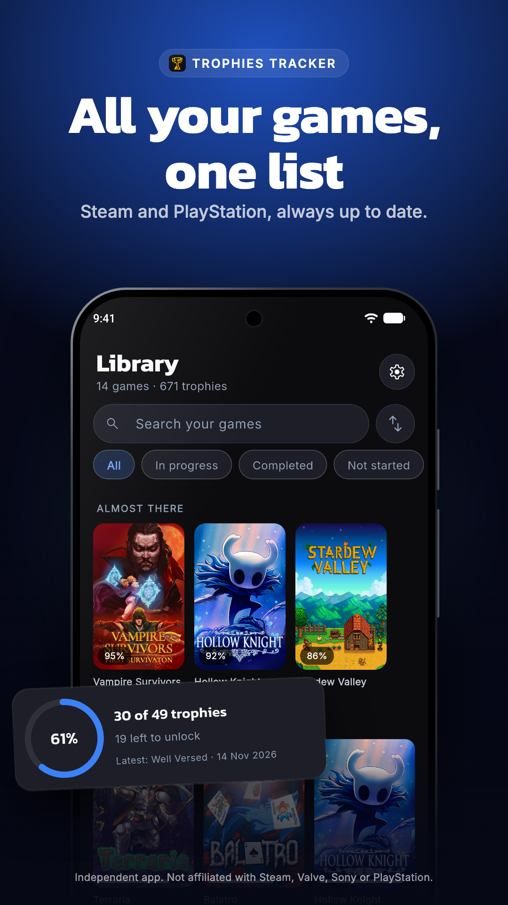
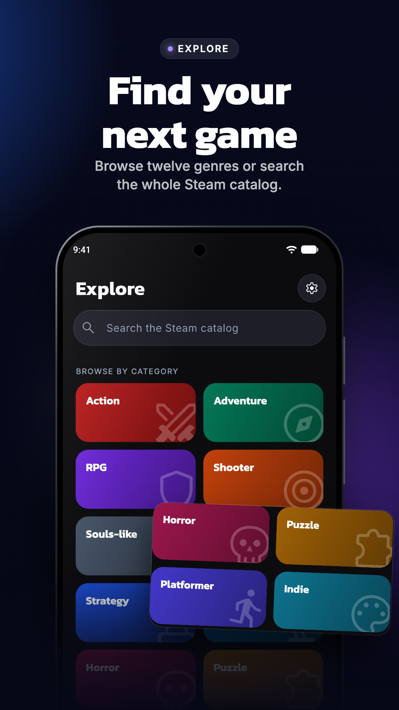
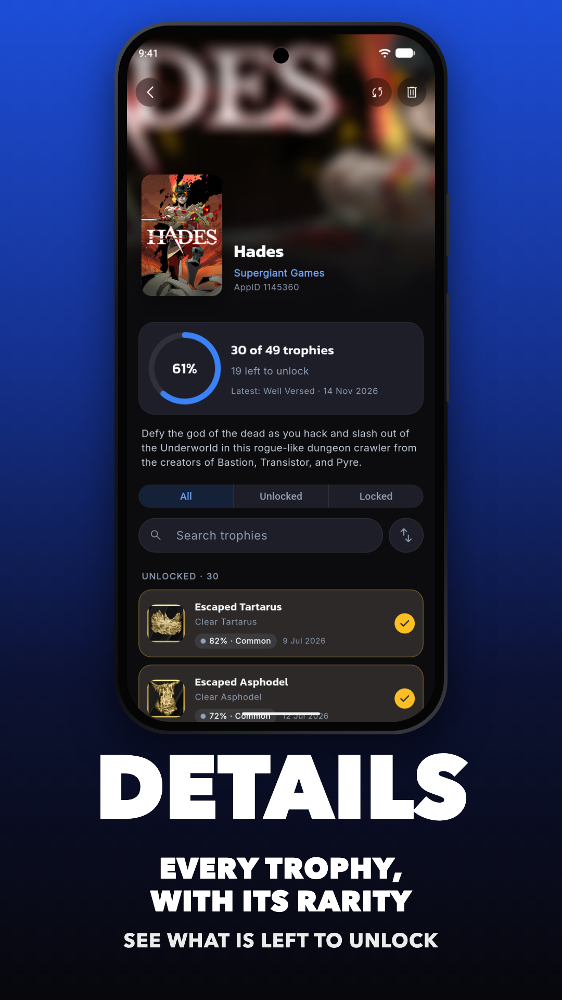
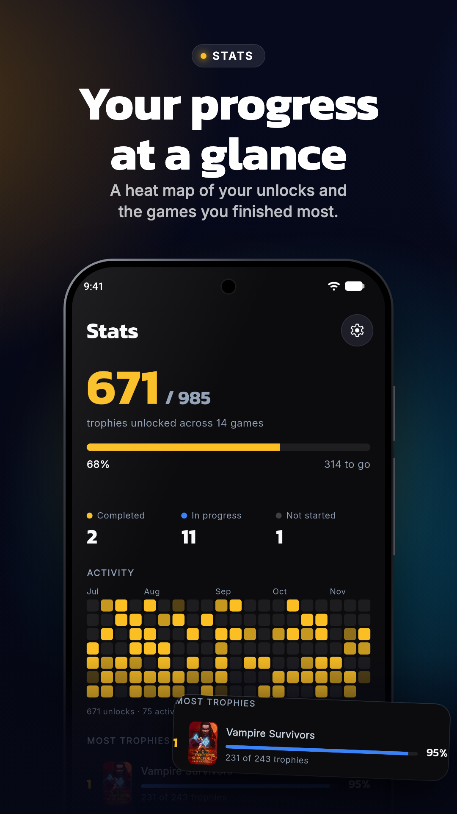
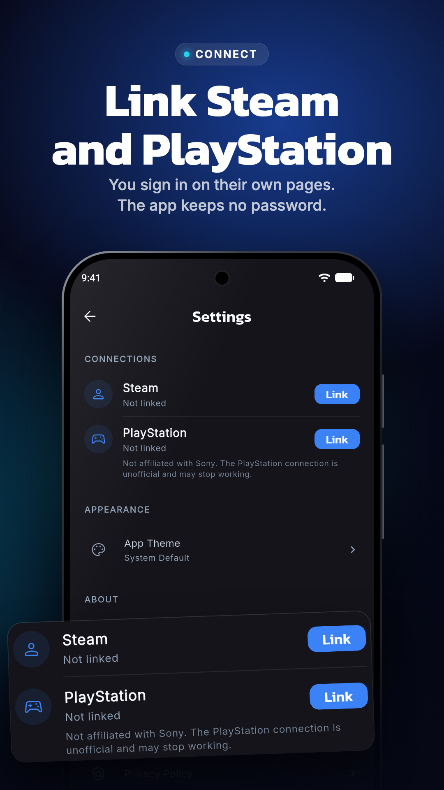
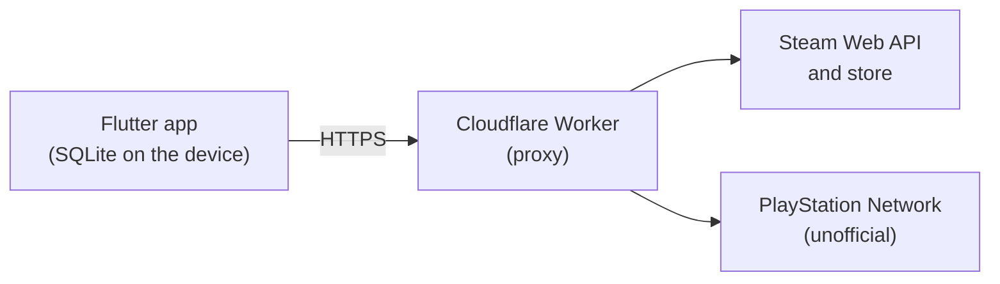

<div align="center">


# Trophies Tracker

**All your Steam achievements and PlayStation trophies in one place.**

Link your accounts, see what is left to unlock in every game, how rare each trophy is, and how your progress builds up over time.


<br />







</div>

> **Status:** version 1.1.0, heading to an internal test on Google Play. iOS builds run, but the app is not on any store yet.

## Features

- **One library for two platforms.** Sync your Steam library and your PS4 and PS5 games with trophies, or add games by hand. Filter by progress, sort, search, and see the games that are *almost there*.
- **Trophies done right.** Every trophy with its description, when you unlocked it and how rare it is (Steam's global unlock rate, Sony's rarity). PlayStation trophies show their grade (bronze to platinum), and hidden ones stay hidden until you tap them.
- **Explore.** Search the whole Steam catalog offline (about 200,000 games, downloaded once), or browse the popular games of twelve genres.
- **Stats.** Your total progress, completed and in-progress games, an activity heat map of the last 20 weeks, your most-trophied games.
- **Local first.** Everything lives in a SQLite database on the device and works offline; syncing only refreshes it.
- **Small footprint.** A short Settings page with Steam and PlayStation as two rows (Link, sync, Unlink), light and dark themes.

## How it works



The app never talks to Steam or Sony directly and holds no API key. Everything goes through a small [Cloudflare Worker](worker/) that:

- keeps the Steam API key as a secret and signs users in with Steam's OpenID, handing the app a session token through a PKCE exchange;
- translates Sony's responses into a stable JSON and stores **nothing** for PlayStation (tokens travel in the body of each request);
- limits the number of requests per client, caches the Steam answers that are the same for everyone, and keeps no request logs.

On the device, the Sony renewal token and the Steam session token live in the secure storage (Keychain / Keystore).

## Tech stack

| | |
|---|---|
| App | Flutter, `flutter_bloc` (Cubits), `go_router`, `get_it`, Drift (SQLite), `freezed` |
| Backend | Cloudflare Worker (plain JavaScript, `node:test`), Workers KV, rate-limit bindings |
| CI | Codemagic: analyze, tests, signed Android builds and a GitHub release |

The code follows a feature-first clean architecture, `lib/features/<feature>/{data,domain,presentation}` plus `lib/core`.

## Getting started

You need Flutter 3.47 or newer (the CI pins 3.47.7), and Xcode or the Android SDK for the platform you target.

```bash
flutter pub get
flutter run
```

By default the app talks to the published Worker. To try changes to the Worker, run it locally and point the app at it:

```bash
cd worker && npx wrangler dev                              # http://127.0.0.1:8787
flutter run --dart-define=PROXY_URL=http://127.0.0.1:8787
```

Other commands:

```bash
flutter analyze
flutter test                                               # app tests
(cd worker && npm test)                                    # Worker tests, no dependencies
dart run build_runner build --delete-conflicting-outputs   # Drift, freezed and JSON code
```

Generated files (`*.g.dart`, `*.freezed.dart`) are committed.

**Android notes.** Gradle 8.14 does not run on Java 25: use JDK 21. The build reads `android/key.properties` for signing even in debug; for a local build create one with dummy `keyAlias`, `keyPassword` and `storePassword` (the file is git-ignored).

**Running your own Worker.** Create a KV namespace and put its id in `worker/wrangler.jsonc`, set the secret with `npx wrangler secret put STEAM_API_KEY`, give the rate-limit bindings namespace ids that are unique in your account, then `npx wrangler deploy`. The privacy policy page is read from the KV key `privacy-policy` (source: [`worker/policy.html`](worker/policy.html)).

## Project layout

```
lib/
  core/            shared code: database, router, DI, widgets
  features/
    account/       Steam sign-in and the Settings page
    game/          library, game page, Explore, repositories
    psn/           PlayStation link and sync
    settings/      theme
    stats/         the Stats page
worker/            Cloudflare Worker, its tests and the privacy policy
docs/              feature plans and screenshots
test/              app tests
```

## Branches and releases

`main` is what gets released: a push to it makes Codemagic build, tag `v<version>` and publish a GitHub release. Work happens on `develop` (or on branches started from it) and reaches `main` through a pull request; both are checked with the analyzer and the tests. To release, bump `version:` in `pubspec.yaml`.

## Documentation

- [`docs/features/`](docs/features/): the plan and the decisions behind each feature (PlayStation, rate limiting, the release test).
- [`REVIEW.md`](REVIEW.md): the code review log, with what is fixed and what is open.
- [`tool/screenshots/`](tool/screenshots/): how the screenshots above were made, to redo them.
- [`CLAUDE.md`](CLAUDE.md): a guide to the code base for AI coding assistants.

## Privacy

The app collects only what it needs to show your libraries: your Steam ID, name and avatar, your PlayStation online ID, and your games and trophies, which stay on your device. See the [privacy policy](https://trophiestracker.alessandro-mazzariol04.workers.dev/policy).

## Legal

Trophies Tracker is an independent project. It is **not affiliated with, authorized, maintained, sponsored or endorsed by** Valve Corporation, Steam, Sony Interactive Entertainment or PlayStation. The PlayStation connection is **unofficial**: it uses the same sign-in and services as Sony's own apps, which Sony has not published for third parties and can change or block at any time. All trademarks, game titles and artwork belong to their owners.

## Support

If you like this project, consider supporting it.

<div align="center">
  <a href="https://ko-fi.com/alessandromazzariol" target="_blank">
    
  </a>
</div>

## License

No license has been chosen yet, so all rights are reserved by default. If you would like to reuse part of the code, please open an issue.

---

Made by [Scafu](https://github.com/Scafu).
